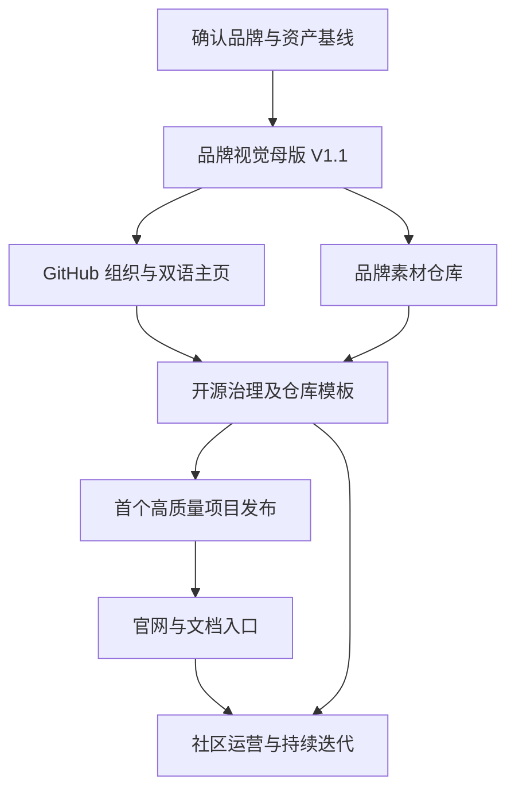

# Primordial Weave · 原初织界

> **Open-source ecosystem roadmap / 开源品牌与组织建设执行计划**  
> **版本：** v1.1 · S0 核查更新（2026-10-25）  
> **制定日期：** 2026-10-25  
> **适用范围：** Primordial Weave 母品牌、GitHub 组织、品牌资源、开源项目及未来官网  
> **核心主张：** Inspired by ancient wisdom. Built for the open future.  
> **中文主张：** 灵感源自古老智慧，创造面向开放未来的工具。

## 0. 使用说明

本文件是一份**持续维护的执行计划**，而非已经完成的工作证明。它将品牌讨论和现有视觉规范落实为可追踪的任务、交付物、验收标准、依赖关系与里程碑。

- `[x]`：现阶段已经产出可供审阅的内容；**不等于已上线、已注册或已发布**。
- `[ ]`：尚未完成或仍需验证。
- **P0 / P1 / P2**：分别表示上线前必做、首批项目发布前应做、成熟期再做。
- **Gate**：进入下一阶段前必须达到的验收条件。
- **时间**：下文“第 1–2 周”等是规划节奏，按实际投入与条件灵活调整，不构成固定交付承诺。
- **身份信息**：组织 GitHub handle、域名、商标、许可证及实际仓库地址仍须以核实结果为准。文中 `<ORG_HANDLE>` 为实际组织名占位符，不应直接发布。

### 0.1 总体目标

建设一个以中国传统哲学和水墨美学为灵感、对国际开发者友好、拥有一致品牌语言与可持续开源工程实践的技术组织。核心是**让工具真正好用**，文化为识别与设计提供思想，而不是代替产品价值。

### 0.2 已确定 / 待最终核定

| 项目 | 当前状态 | 备注 |
|---|---|---|
| 品牌英文名 | ✅ 方向确认：**Primordial Weave** | 品牌英文拼写保持统一 |
| 品牌中文名 | ✅ 当前采用：**原初织界** | 作为品牌中文表达，并非古籍原词 |
| 品牌宣言 | ✅ 已拟定中英文版本 | 发布时逐字统一 |
| 核心视觉 | ✅ 选定“传统黑白太极 + 一笔墨环 + 克制朱砂” | AI 视觉稿≠正式矢量母版 |
| 辅助印章 | ◐ 「織」字朱砂篆意稿 | **小篆字形尚需考证并重绘** |
| 视觉规范 | ✅ 《品牌视觉识别与应用规范 V1.0》已成稿 | 后续固化成可执行源文件 / Tokens |
| GitHub 中英文 README | ✅ 文案草稿已有 | 实际组织主页的跳转与图片尚待上线验证 |
| GitHub Banner / Mark / OG | ◐ 有图稿与高清探索版本 | 需要从统一定稿母版重新输出 |
| 正式 GitHub 组织、域名、品牌商标 | ◐ S0 进行了有限核查，尚未确权 | 当前连接无组织记录；域名未获得可验证的实时结果；已记录近似词商标风险 |
| 开源项目模板、首批发布、官网 | ☐ 进入实施计划 | 不预设这些已上线 |

---

## 1. 全局实施路线



| 阶段 | 优先级 | 主要成果 | 进入下一阶段的 Gate |
|---|---|---|---|
| S0 品牌和身份基线 | P0 | 名称、账号、源文件与权属清单 | 管理入口明确、素材可追溯 |
| S1 视觉母版 V1.1 | P0 | 主 Logo SVG、印章 SVG、导出包、用法规范 | 结构统一、大小尺寸与暗色模式通过 |
| S2 GitHub 组织主页 | P0 | `.github`、双语首页、头像、链接与组织资料 | 组织首页及双语切换正常 |
| S3 开源工程基础设施 | P1 | 社区文件、许可证、模板、CI 和安全策略 | 新项目可用模板快速初始化 |
| S4 首个项目正式发布 | P1 | 至少 1 个真实、可运行、可维护的公开项目 | 使用说明、版本、构建与维护机制齐备 |
| S5 官网与知识中心 | P2 | 双语官网、项目目录、品牌介绍、文档入口 | 内容一致、响应式、无障碍与 SEO 基线通过 |
| S6 社区与长期运营 | 持续 | 贡献者机制、版本节奏、项目组合管理 | 稳定维护且可持续改进 |

> **推荐决策：** 先固定母版并把 1 个产品做好，再扩展第二批项目。官网可以先使用极简静态版本，避免“品牌资产很多但缺少真正可用的软件”。

---

## 2. S0｜品牌与数字身份基线（P0）

> **2026-10-25 执行核查：部分完成，Gate 0 未通过。** 具体证据、未确认事项与可执行链接参见 [`brand/identity.md`](brand/identity.md)、[`S0-REPORT.md`](S0-REPORT.md)。`[x]` 仅代表注明的成果已经存在，不意味着注册或授权已完成。

**目标：** 明确源文件、账号、名称、资产归属及可发布内容，防止重名、源文件丢失和误用。

### S0 工作清单（核对后的真实状态）

- [x] **GitHub 组织及恢复确权**：已查询当前连接，未返回组织；仍需最终账号持有人用创建界面验证 `primordialweave` 并确认所有权与恢复方式。
- [x] **域名实时核验及决策**：已整理 `primordialweave.com` 等候选，但未取得可验证的实时注册状态；须由注册商前台核实。
- [ ] **正式商标及同业名称冲突清查**：已做搜索初筛、记录近似词风险与官方查询入口；主要市场完整检索仍待完成。
- [x] **品牌基本口径固定**：中英文名、正式英文宣言、中文宣言及品牌核心视觉语义已记录在 `brand/identity.md`。
- [x] **素材与文档资产盘点**：整理 Word/MD、历史探索图、当前 Logo/OG/Banner/印章等文件，详见 `brand/asset-inventory.csv`。
- [x] **建立素材来源与版本底账**：为可访问文件保存相对路径、用途、尺寸、SHA-256、AI 生成/导出来源说明与“未获正式批准”状态；原始创作人和实际授权细节仍待核验。
- [ ] **账号安全与恢复实际设置**：已建立 `brand/account-security-checklist.md`，但 2FA、第二 Owner、恢复码等必须由账号所有者完成。
- [ ] **品牌与代码许可正式决策**：已草拟 `brand/rights-and-licenses.md`；标志、图片、字体、文档与源码分别授权的原则需持有人批准。

**交付物：** `brand/identity.md`、`brand/asset-inventory.csv`、`brand/rights-and-licenses.md`、`brand/account-security-checklist.md`、`S0-REPORT.md`。

**Gate 0：** `primordialweave` 组织及恢复权确认；域名处置有清楚决定；目标市场商标风险审查完成；授权策略批准；素材档案可追溯。**截至本次核查未通过。**

---

## 3. S1｜品牌视觉母版 V1.1（P0）

**目标：** 从 AI 视觉参考转成**可重复导出、几何准确、在所有尺寸都一致**的正式品牌标识。

### 3.1 Logo 结构定稿

- [ ] 用精确路径重绘标准黑白太极：正圆外轮廓、S 形阴阳分界、双鱼眼位置和比例统一。
- [ ] 保留一条主要的“一笔墨环”，去除多余厚重圆环、星环、祥云和珠宝式浮雕。
- [ ] 确定是否保留一条极细暖灰 / 古金辅助内缘线；仅当 64 px 下仍不造成噪声时使用。
- [ ] 明确朱砂点方案：标准版顶部、底部成轴；小尺寸版可省略。
- [ ] 建立四种**同源**母版：极简 Mark、带印章标准 Mark、横向字标组合、纯黑 / 纯白单色版。
- [ ] 确定正式字标字体与字距，核对许可，留存矢量转曲字标（不提交字体文件）。
- [ ] 画出几何网格、安全距离、最小尺寸和禁用范例，归入品牌规范 V1.1。

### 3.2 「織」字朱砂印章

- [ ] 选择固定印文：建议沿用**「織」**，与 Weave 对应；注意这是繁体「织」。
- [ ] 查证「織」的规范小篆写法，明确采用何种可考证篆体或篆刻风格；**不要以 AI 生成的似字笔画直接作为正式小篆**。
- [ ] 根据核定字形重绘印面和印边，确定朱文/白文样式与方形比例。
- [ ] 输出可编辑 SVG，提供正色 / 单色、纹理版 / 无纹理版。
- [ ] 在 Mark 中使用时保持印章为外置小面积辅助识别；favicon 与普通 GitHub 头像默认不使用印章。

### 3.3 推荐设计 Tokens（V1.0 基线值，最终以 V1.1 核定为准）

| 设计 Token | 色值 | 作用 |
|---|---|---|
| `--pw-ink` | `#242424` | 墨黑 / 主文案 |
| `--pw-paper` | `#F5F1E8` | 宣纸白 / 浅底 |
| `--pw-mist` | `#B9B7AF` | 水墨远山 / 装饰灰 |
| `--pw-stone` | `#686A68` | 辅助文字 |
| `--pw-cinnabar` | `#A32E28` | 朱砂红 / 印章 |
| `--pw-antique-gold` | `#B49C73` | 极细辅助线 |

推荐主色为墨黑与宣纸白，朱砂作为少量点睛色。大面积避免高饱和红金、金属浮雕及繁复玄幻纹样。正常文本须校验实际渲染对比度，不能将雾灰用于小字号正文。

### 3.4 物料导出清单

| 文件（建议） | 格式与规格 | 场景 |
|---|---|---|
| `mark-minimal.svg` | SVG | 一切图标母版 |
| `mark-standard-seal.svg` | SVG | 带「織」印的标准标志 |
| `wordmark-horizontal.svg` | SVG | 官网 / 文档页眉 |
| `seal-zhi.svg` | SVG | 独立印章 |
| `avatar-1024.png` | 1024 × 1024 PNG | GitHub 组织头像 |
| `avatar-512.png`、`avatar-256.png` | PNG | 小尺寸和发布工具 |
| `banner-readme.png` | 建议约 2000 × 500（具体比例另行定稿） | GitHub README 头图 |
| `og-general.png` | 1200 × 630 PNG | 通用 Open Graph / 网站分享 |
| `social-preview-github.png` | 1280 × 640 PNG，压缩以满足平台要求 | GitHub 仓库社交预览（与通用 OG 分开） |
| `favicon.svg`、`favicon.ico` | SVG + 多尺寸 ICO | 浏览器图标 |
| `mark-dark.svg`、`mark-light.svg` | SVG | 深 / 浅背景场景 |

**注意：** 所有物料须由高分辨率源文件或矢量母版直接导出；**严禁从品牌拼贴预览图裁切并放大冒充高清成品**。水墨纹理可以叠加，但不得扭曲几何、鱼眼或印章字形。

### 3.5 验收标准（Gate 1）

- [ ] 黑白太极、墨环、朱砂点在各个导出规格中保持同一造型，不存在“每次生成都不一样”的问题。
- [ ] 32 / 64 / 128 px 头像显示清楚，圆形裁切不伤主标。
- [ ] 浅色、深色、纯黑白背景均有可读版本。
- [ ] Banner 的标题、标语及印章无错字，印章字形经过核定。
- [ ] 源文件、颜色和许可证说明一起提交；保留编辑源与导出脚本/参数。

---

## 4. S2｜正式 GitHub 组织与双语主页（P0）

**目标：** 用户进入 GitHub 组织就能立刻识别品牌、理解做什么、切换语言，并找到有价值的项目。

### 4.1 组织信息

- [ ] 创建或确认组织账号，配置头像、名称、公开简介、官网 URL 与联系渠道。
- [ ] 建立组织管理角色、成员邀请流程与公开/私有仓库策略。
- [ ] 设置成员二次验证要求与最小权限，定期审查访问权限。
- [ ] 配置必要的仓库默认安全设置、分支保护和自动化权限。
- [ ] 避免组织简介做成纯哲学宣言：写清楚是一个开源技术组织。

**组织简介建议（英文）：**  
`Open-source tools shaped by Eastern philosophy and thoughtful design.`

### 4.2 组织主页结构

```text
.github/                          # GitHub 组织级仓库（public）
├── profile/
│   ├── README.md                 # 默认英文
│   ├── README.zh-CN.md           # 简体中文
│   └── assets/
│       ├── banner-readme.png
│       └── mark-minimal.png
├── CONTRIBUTING.md               # 可复用的组织级社区规范
├── CODE_OF_CONDUCT.md
├── SECURITY.md
├── ISSUE_TEMPLATE/
│   ├── bug_report.yml
│   ├── feature_request.yml
│   └── config.yml
└── PULL_REQUEST_TEMPLATE.md
```

- [ ] README 首屏顺序：**Banner → 核心主张 → 一句话组织定位 → 领域 → 居中语言切换 → 精选项目**。
- [ ] 英文与中文版共用同一横幅与主要信息层次，保留完整品牌理念与项目入口。
- [ ] 使用 GitHub 可正常点击的语言 Badge，不使用需要脚本执行的“假按钮”。
- [ ] 对**组织首页实际渲染场景**检查相对 URL：若语言链接解析不可靠，改为完整链接（替换实际 handle / 默认分支）。
- [ ] 测试图片、Badge 和仓库链接是否能在 GitHub Web、移动端和浅/深色模式正常打开。
- [ ] 置顶少量已公开且具代表性的真实项目，避免空仓库占据首屏。

**双语切换示例（按实际组织与分支替换占位符后使用）：**

```html
<p align="center">
  <a href="https://github.com/<ORG_HANDLE>/.github/blob/main/profile/README.md">English</a>
  &nbsp;·&nbsp;
  <a href="https://github.com/<ORG_HANDLE>/.github/blob/main/profile/README.zh-CN.md">简体中文</a>
</p>
```

### 4.3 Gate 2

- [ ] 访客不登录也能看到组织首页与 Banner。
- [ ] 英文 / 中文链接都能正确访问，且版本互相返回。
- [ ] Bio、Logo、品牌宣言、文化用语、图片命名与正式品牌母版一致。
- [ ] 不包含虚构的已上线产品、尚未存在的贡献渠道或失效链接。

---

## 5. S3｜开源工程与治理模板（P1）

**目标：** 后续每一个项目都可以遵循相同的质量基线，而不是重复从零编写规范。

### 5.1 建立仓库（建议）

```text
<ORG_HANDLE>/
├── .github                   # 组织主页与共享社区健康文件
├── brand                     # VIS / SVG 母版 / 颜色 / 导出物 / 授权
├── project-template          # 新项目通用仓库模板
├── website                   # 官网源代码（S5）
└── <first-real-project>      # 首个真正交付的软件项目
```

> `brand` 和 `website` 是独立的建议仓库；不要将品牌内部素材、账号凭据或未确认权利的第三方资产无差别公开。

### 5.2 `project-template` 最小内容

- [ ] `README.md`（英文）和 `README.zh-CN.md`（中文）。
- [ ] `LICENSE`：按每个项目的实际意图选择，不机械使用统一许可证。
- [ ] `CONTRIBUTING.md`：开发环境、提交规范、审查流程。
- [ ] `CODE_OF_CONDUCT.md`：明确协作与社区行为边界。
- [ ] `SECURITY.md`：私下报告漏洞的方法；不要要求公开发布安全敏感细节。
- [ ] `CHANGELOG.md`：版本与用户可见变化。
- [ ] `docs/`：使用指南、示例、架构说明（按项目类型选取）。
- [ ] `.github/ISSUE_TEMPLATE/`：Bug、Feature Request、Documentation。
- [ ] `.github/PULL_REQUEST_TEMPLATE.md`：变更概要、测试、截图、关联 issue。
- [ ] 基本 CI：lint、测试、构建、依赖安全检查；按语言和平台适配。
- [ ] 版本策略：建议采用语义化版本或说明项目适用的版本规则；附 release notes。
- [ ] 加入品牌关联：`Part of the Primordial Weave open-source ecosystem.` 和组织入口。

### 5.3 工程和安全基线

- [ ] 默认分支受保护，合并需通过必要的状态检查。
- [ ] 减少自动化 Token 权限，禁止在代码 / 日志 / README 中存储凭据。
- [ ] 配置依赖更新提醒和基础静态检查；项目合适时引入 CodeQL。
- [ ] 依项目风险制定漏洞披露响应方式、维护者轮值和 EOL 规则。
- [ ] 保持可复现构建说明，能在干净环境中按 README 安装与运行。
- [ ] 对 macOS 原生应用明确最低系统版本、签名/公证策略与发布渠道（仅适用时）。
- [ ] 区分代码许可、品牌商标、艺术素材授权、第三方依赖和字体授权。

### 5.4 Gate 3

- [ ] 使用 `project-template` 新建测试仓库，验证文件路径、Badge、链接与 CI 均正常。
- [ ] 新贡献者无需私人指导即可运行基本示例、提交 Issue 和 PR。
- [ ] 协议、品牌素材使用限制及第三方权属没有互相矛盾。

---

## 6. S4｜首个真正可用的项目（P1）

**目标：** 让组织的价值不止于视觉设计，而是通过可使用的软件、可靠文档和版本发布得到验证。

### 6.1 项目选择与范围

候选可包括已有的 **WeGit**（macOS Git 客户端）以及文化命名方向的工具；最终**只选择一个开发状态最成熟、能够较快达到可公开交付标准的项目**作为首发。不要因为名称偏好就提前承诺尚不存在的项目功能。

- [ ] 列出现有候选仓库：功能、进度、发布条件、技术债、第三方依赖、可开源范围。
- [ ] 选择首发项目，并把一句话价值主张写成用户能理解的语言。
- [ ] 定义最小可交付版本（MVP）：解决什么问题、不解决什么问题。
- [ ] 确保对外项目名、图标、README 和操作截图对应**真实功能**。
- [ ] 按实际情况决定是否公开源码；对无法开放的内容明确边界，不做虚假开源宣称。

### 6.2 首发项目检查表

- [ ] 可下载/安装或可从源码编译。
- [ ] README 清楚写出用途、主要功能、截图、快速开始、常见问题、兼容性。
- [ ] 中英文文案至少覆盖核心使用流程。
- [ ] 可验证的基础测试、构建、静态检查通过。
- [ ] 发布版本号、变更日志、已知限制和 License。
- [ ] 反馈与安全漏洞的报告渠道明确。
- [ ] 项目 Logo 保留独特功能符号，不机械复制组织太极图。
- [ ] GitHub 组织首页加入真实项目入口，首个项目置顶。

### 6.3 项目命名及子品牌规则

| 项目名（候选/示例） | 中国文化联系 | 使用前置条件 |
|---|---|---|
| `WeGit` | 现代开发工具，组织文化由设计语言体现 | 已有项目身份可保留；明确与母品牌关系 |
| `Dao` · 道 | 本源与系统原则 | 必须有真实功能和对应含义，检查重名 |
| `Taiji` · 太极 | 变化、平衡、循环 | 可用于动效 / 状态相关产品，避免宗教化宣称 |
| `Fangcun` · 方寸 | 篆刻、印记、精细工具 | 必须能解释名字与产品使用场景的联系 |
| `Shanhai` · 山海 | 想象、神话、探索 | 适合文化或探索类项目，不先占空仓库 |

**命名原则：** 便于英文环境发音、能解释文化内涵、与软件用途有关；首屏介绍功能，深入文档再阐释传统文化。项目要有独立视觉识别，但共享低饱和墨色、宣纸白与克制朱砂的家族风格。

### 6.4 Gate 4

- [ ] 至少 1 个真实公开项目达到“陌生用户可按文档使用/构建”的状态。
- [ ] 有可复现的版本、可靠的反馈入口和明确维护责任。
- [ ] README 文案与软件实际功能一致，不把计划中的功能写成已发布功能。

---

## 7. S5｜官网与数字品牌体验（P2）

**目标：** 建立一个轻量、快速、可维护的双语品牌入口，而不是优先构建复杂平台。

### 7.1 网站 MVP

- [ ] 确认域名、托管方式、DNS 和 HTTPS；仓库与部署权限归组织控制。
- [ ] 首页：品牌理念一句话 + 主视觉 + **Explore Projects** 入口。
- [ ] 项目页：真实项目简介、平台、状态、GitHub 链接、文档入口。
- [ ] About：品牌故事、文化借鉴说明、开源价值观。
- [ ] Brand：Logo 使用规则、下载、权利与许可声明。
- [ ] Join：贡献流程、社区规范及联系入口。
- [ ] 中英文切换：URL 结构明确、语言间互链、页面内容同步。
- [ ] 响应式布局、键盘访问、适当对比度、替代文本和 reduced-motion 支持。
- [ ] SEO / OG / sitemap / robots 配置；只使用真实可验证的项目与团队资料。

### 7.2 技术与视觉建议

- 首版优先静态内容与少量交互，避免不必要的后端与登录系统。
- 首页视觉使用已定稿的 SVG 母版和淡山水，留白大于装饰密度。
- 动效应克制、可关闭，不为表达太极而加入持续高速旋转。
- 站点可用 GitHub Pages 或其他适合静态部署的方式，最终根据实际需求选择。
- 对外品牌图片提供明确命名和 alt 文本，不让 AI 生成图代替项目截图。

### 7.3 Gate 5

- [ ] 电脑、手机端可阅读，加载速度与基础无障碍审核通过。
- [ ] 官网与 GitHub 的品牌名、标语、项目列表、联系方式一致。
- [ ] 双语页面完整且没有空链接、错误图片和失效入口。

---

## 8. S6｜社区运营、项目治理与持续迭代（持续）

### 8.1 社区机制

- [ ] 为 Issue / PR 建立友善且清楚的处理规则；公开维护者可以承担的支持范围。
- [ ] 新手标签例如 `good first issue` 仅用于真正适合新手的事项。
- [ ] 按项目情况建立 Discussion / RFC 流程，避免所有决策只存在私人聊天中。
- [ ] 对外公布维护状态，例如 active / maintenance / archived。
- [ ] 用版本发布说明记录影响使用者的更改及潜在兼容性问题。
- [ ] 对外部贡献者明确代码归属、贡献协议或 DCO 选择（确有需要再使用）。

### 8.2 品牌治理

- [ ] `brand` 仓库存放不可变更的发布标签，例如 `v1.1.0`，并保留修订记录。
- [ ] 每次改动 Logo、印章或核心色彩都经过设计审核与小尺寸验收。
- [ ] 子项目可拥有自己的主图形和附加色；不能擅自修改母品牌标志几何与核心印章。
- [ ] 品牌图像更新需同步 README、官网、OG、社交预览和相关仓库模板。
- [ ] 后续新增语言应优先覆盖用户需求和长期维护能力，避免多语言版本长期失同步。

### 8.3 轻量回顾节奏（建议）

| 节奏 | 内容 | 输出 |
|---|---|---|
| 每周 | 处理关键 Issue/PR、构建失败、发布阻塞 | 简短维护记录 |
| 每月 | 核对项目状态、文档失效、依赖升级、视觉一致性 | `CHANGELOG` / TODO 更新 |
| 每季度 | 复查首批项目价值、官网数据、社区问题、品牌迭代请求 | 季度总结与下一阶段计划 |

**注意：** 不以 Star 数量作为单一成功标准；更关注真实可用性、持续维护、文档完整和贡献者体验。

---

## 9. 参考排期：第 1–12 周（可滚动调整）

| 时间窗口 | 建议重点 | 可检验里程碑 |
|---|---|---|
| 第 1 周 | S0：名称、账号、素材和授权清单 | 数字身份与素材基线完成 |
| 第 2–3 周 | S1：主 Logo / 印章矢量化、Tokens 和统一导出 | Brand V1.1 通过 Gate 1 |
| 第 3–4 周 | S2：组织 `.github`、中英文主页和头像 | GitHub 首页通过 Gate 2 |
| 第 4–6 周 | S3：模板仓库、社区文件、CI 和维护原则 | 新仓库模板通过 Gate 3 |
| 第 5–9 周 | S4：筛选并打磨首发软件 | 第一个项目通过 Gate 4 |
| 第 9–12 周 | S5：官网 MVP、项目目录和统一导航 | 官网通过 Gate 5 |
| 全阶段 | S6：文档、反馈、品牌资产版本管理 | 运营机制逐步完善 |

> 排期有重叠是为了并行处理依赖较少的任务；**品牌母版先于正式传播物料，模板先于多项目扩张，真实产品先于大规模推广**。

---

## 10. 资源组织、交付文件和命名约定

建议在品牌仓库内按以下方式管理资料：

```text
brand/
├── README.md
├── README.zh-CN.md
├── PLAN.md                    # 本计划：或在组织治理仓库维护并链接
├── guidelines/
│   ├── brand-guidelines.md
│   ├── logo-usage.md
│   ├── seal-usage.md
│   ├── typography.md
│   └── licensing.md
├── design-tokens/
│   ├── colors.json
│   └── typography.json
├── sources/                   # 经审查的可编辑母版与制作说明
│   ├── logo/
│   └── seal/
├── exports/
│   ├── svg/
│   ├── png/
│   ├── og/
│   └── favicon/
├── references/                # 灵感稿与非定稿素材，明确标注草稿
└── CHANGELOG.md
```

### 交付文件命名

- 正式：`pw-mark-minimal-light-v1.1.svg`、`pw-mark-standard-seal-v1.1.svg`。
- 渠道：`pw-github-avatar-1024-v1.1.png`、`pw-readme-banner-v1.1.png`。
- 社交：`pw-og-general-1200x630-v1.1.png`、`pw-github-social-1280x640-v1.1.png`。
- 印章：`pw-seal-zhi-cinnabar-v1.1.svg`。
- 草稿资产必须带 `draft` 或放在 `references/`，不得与正式版混放。

---

## 11. 风险、约束与避免返工策略

| 风险 | 后果 | 预防与处理 |
|---|---|---|
| GitHub handle、域名或商标冲突 | 组织/域名需更名 | S0 提前核实，并在资产中使用可替换配置 |
| AI 标志曲线每次不同 | 各渠道品牌不统一 | 一次性锁定 SVG 母版、从母版导出 |
| 小篆「織」字形错误 | 文化准确性和专业性受损 | 查证字书，人工矢量重绘并二次审校 |
| 图片从预览图裁切放大 | 模糊、像素化、不能印刷 | 素材独立制作并保留高分辨率源文件 |
| 品牌使用权 / 字体许可不明 | 发布或商业化法律风险 | 单列授权说明；字体不随品牌包分发 |
| 英文中文 README 内容不一致 | 用户理解偏差 | 两份文案共同评审，修改同步提交 |
| 宣传先于项目功能 | 容易造成期望落差 | 先发布真正可用的工具和真实截图 |
| 过度追求装饰和“国风” | 现代技术品牌可读性下降 | 以墨色留白为主，严守最小尺寸及视觉权重 |
| 组织维护依赖单个个人 | 密钥、仓库和发布中断 | 最小权限、多因素验证、恢复与交接记录 |
| 多项目同时启动 | 分散精力、长期空仓库 | 首发一个项目，验收合格再扩展 |

---

## 12. 里程碑与成功度量

### M1｜品牌定型

- [ ] 母版的标志、印章、颜色与字标可从同一源文件一致导出。
- [ ] 通过 32 / 64 / 128 px、浅色 / 深色、1:1 / 横幅 / OG 检验。
- [ ] 品牌版权/授权与篆印考证记录明确。

### M2｜组织上线

- [ ] 公开组织可访问，Bio、头像、主页正确。
- [ ] 中英 README 互相切换；无失效图片与链接。
- [ ] 品牌仓库及共享社区规范就位。

### M3｜工程可持续

- [ ] 新仓库模板完整，测试构建正常。
- [ ] 至少 1 个真实项目提供可复现的安装/编译说明与版本发布。
- [ ] 安全反馈、贡献者入门、维护责任与许可证可查。

### M4｜生态对外展示

- [ ] 官方站点展示实际项目及准确介绍，双语内容同步。
- [ ] GitHub、官网、分享图、项目文档采用一致品牌母版。
- [ ] 建立例行更新与归档机制，过期链接和错误文档能持续被修正。

**不建议的单一 KPI：** “必须获得多少 Star 或关注者”。  
**建议持续关注：** 活跃维护项目数量、首次上手成功率/反馈、未解决关键缺陷、版本发布与 CI 稳定性、文档可用性及外部贡献体验。

---

## 13. 下一次执行会议 / 开工清单（从这里开始）

按下面的顺序推进，其他项目先不分散注意力：

1. **确认组织 GitHub handle 和正式官网域名的真实可用情况。**
2. **选定最终太极与墨环视觉母版，重绘矢量；查证并重绘「織」字小篆印章。**
3. **从母版导出 GitHub 头像、带印章 Banner、通用 OG、GitHub 社交预览与深色版。**
4. **发布 `.github/profile/README.md` 与 `README.zh-CN.md`，测试语言切换。**
5. **建立 `brand` 与 `project-template` 仓库，补足基本社区、许可及安全文件。**
6. **评估 WeGit 等现有项目的成熟度，选定一个项目作为第一批公开发布对象。**
7. **项目能够真实使用后再制作官网 MVP；随后逐步扩展 Dao / Taiji / Fangcun / Shanhai 等文化命名项目。**

### 近期最关键的三个文件

- `PLAN.md`：本计划，持续更新优先级、任务状态与里程碑。
- `brand-guidelines.md`：品牌规范 V1.1，以标准 SVG 与 Tokens 为核心。
- `.github/profile/README.md` + `.github/profile/README.zh-CN.md`：GitHub 对外第一入口。

---

## 14. 变更日志

| 日期 | 版本 | 变更 |
|---|---|---|
| 2026-10-25 | v1.0 | 结合现有《Primordial Weave 品牌视觉识别规范 V1.0》和 GitHub 组织建设目标，建立完整分阶段执行计划；补齐任务、验收、依赖、风险和长期维护机制。 |

---

*Primordial Weave · 原初织界*  
*太初生万象，万象织成章。*
