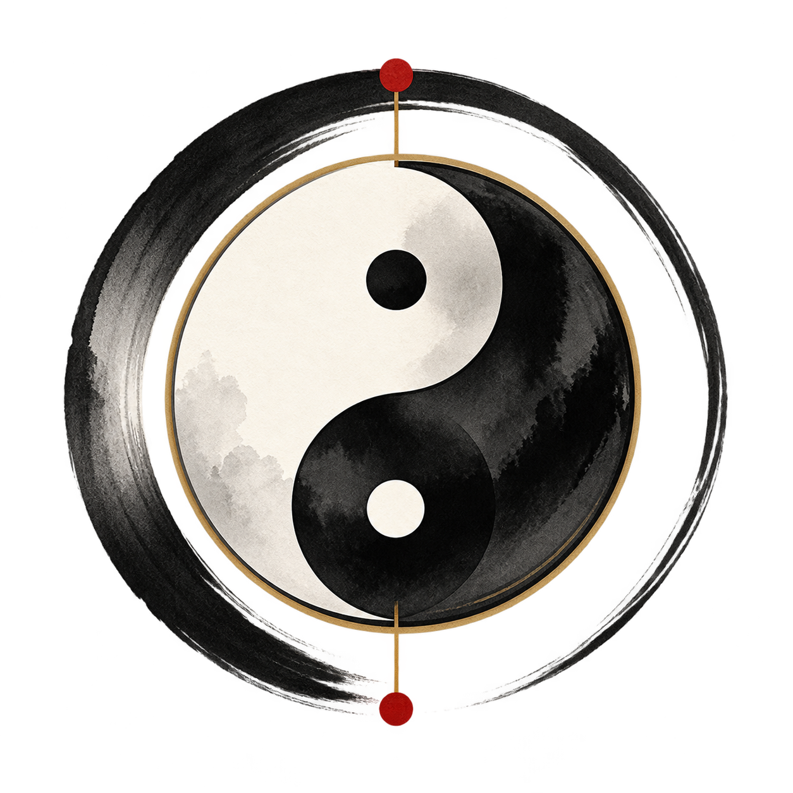
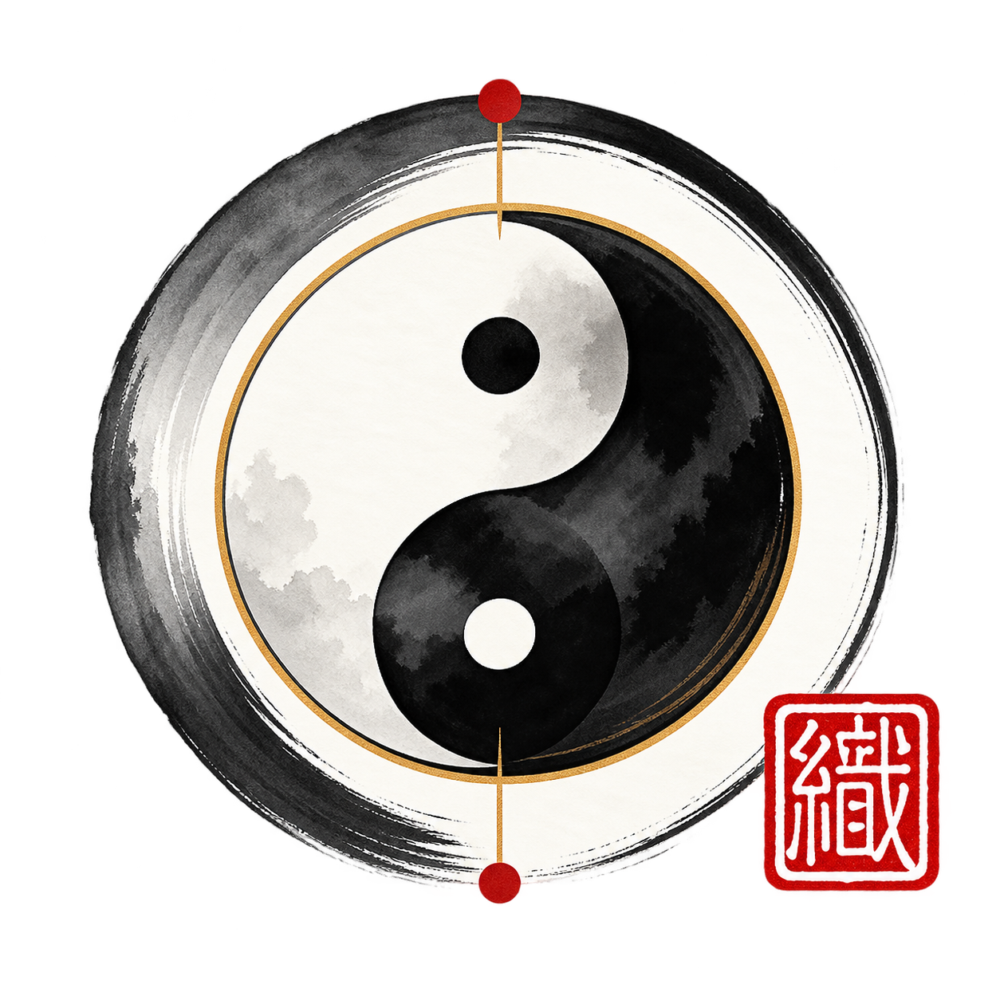
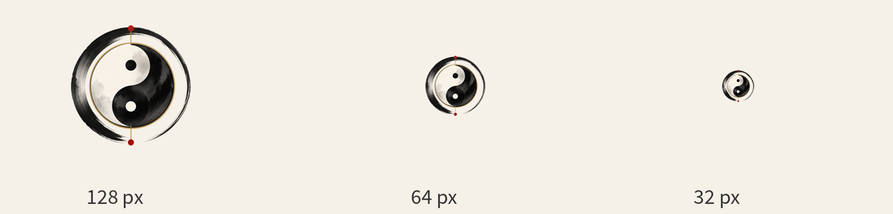

# Primordial Weave｜原初织界

**品牌视觉识别与应用规范（Brand Identity Guidelines）· V1.0**


Inspired by ancient wisdom. Built for the open future.

灵感源自古老智慧，创造面向开放未来的工具。

|  |  |
|:---:|:---:|
| 识别核心：太极 × 墨环 | 标准形式：朱砂篆印 |

VISUAL SYSTEM · OPEN SOURCE · TOOLS · CULTURE

文档版本 V1.0（品牌规范建议稿） \| 2026 年 10 月 \| 适用于 GitHub 组织及其关联开源项目

> **文档定位 / 使用说明**
>
> 本文将已确定的品牌方向转化为可以执行的视觉与文字规则。现有图像是视觉基准稿；正式 SVG、字体字标和严格小篆字形需要按本文规则精修、核验后发布。

# 00 品牌总览

BRAND AT A GLANCE

> **一句话定义**
>
> Primordial Weave 是一个从中国传统哲学与水墨美学汲取灵感、面向国际开发者的开源技术品牌。它以「太初生万象，万象织成章」为精神内核，以清晰、克制、可靠的设计与工程实践为表达。

## 已确定的品牌基础

| **要素**   | **规范内容**                                             |
|------------|----------------------------------------------------------|
| 正式英文名 | Primordial Weave                                         |
| 中文品牌名 | 原初织界（当前选定的中文对应名）                         |
| 品牌主张   | Inspired by ancient wisdom. Built for the open future.   |
| 中文表达   | 灵感源自古老智慧，创造面向开放未来的工具。               |
| 品牌领域   | Open Source · Tools · Systems · Culture                  |
| 核心形象   | 标准黑白太极 + 一笔水墨圆环 + 克制朱砂点                 |
| 辅助识别   | 朱砂「織」字篆意印章；在正式使用前须作字形考证与矢量重绘 |
| 总体风格   | 水墨、留白、温润宣纸、简洁秩序、东方哲学                 |

## 阅读与执行路径

| **阶段** | **执行重点**                       | **最终产物**   |
|----------|------------------------------------|----------------|
| 01 定义  | 统一名称、主张、核心符号、禁用范围 | 品牌主语义     |
| 02 定型  | 重绘太极 / 墨环几何、核定「織」印  | SVG 母版       |
| 03 落地  | 导出头像、Banner、OG、README 模板  | 渠道应用       |
| 04 治理  | 制定命名、评审、文件版本与更新流程 | 长期品牌一致性 |

## 目录

01 品牌战略与哲学 · 02 Logo 体系与构图 · 03 色彩、字体和图像语言 · 04 印章与品牌辅助元素

05 数字产品与 GitHub 落地 · 06 子项目架构与语言表达 · 07 制作交付与治理 · 附录：实施清单与 Token

# 01 品牌战略与哲学

BRAND FOUNDATIONS

## 1.1 名称解释

**Primordial**：太初、原初、本源；强调一切结构和创造的起点。  
**Weave**：编织、交织；强调不同思想、模块与个体在关联中构成整体。

二者组合不是对某个古代专有名词的直接翻译，而是以现代英文重新表达中国哲学中的生成、变化与关联观。中文「原初织界」是品牌化命名，不应将其解释成已有的历史术语。

## 1.2 品牌核心叙事

大道无形，万物自生。天地之间的秩序，并非由繁复堆砌获得，而是在对立与共生、变化与平衡中自然呈现。软件世界亦是如此：微小的想法成长为工具，独立的组件形成系统，开放的协作连接起无数创造者。

Primordial Weave 希望从这种思想中汲取灵感，让东方审美的克制、工匠精神的严谨与开源协作的开放精神共同参与现代软件创造。

这里的「道」「阴阳」等概念用于启发品牌思想，不代表品牌所属某个宗教组织，也不将现代图形误称为古代历史文物。

## 1.3 使命、愿景、承诺

| **层级**      | **声明**                                                                           |
|---------------|------------------------------------------------------------------------------------|
| 使命 Mission  | 创造简洁、可靠、经过认真打磨的开放工具；让经典思想在现代交互与工程中获得新的表达。 |
| 愿景 Vision   | 建设一个兼具实用价值、设计品质与文化识别度的长期开放生态。                         |
| 承诺 Promise  | Every detail has a purpose. 每一处细节都有存在的理由。                             |
| 价值观 Values | Simplicity / Balance / Craft / Openness / Longevity（简、和、工、开、久）。        |

## 1.4 品牌性格与受众

| **维度** | **我们是**             | **我们不是**                 |
|----------|------------------------|------------------------------|
| 气质     | 沉静、坚定、有文化深度 | 炫技、堆砌神秘符号           |
| 技术     | 精确、实用、可维护     | 仅有概念、缺少工程质量       |
| 沟通     | 开放、谦逊、国际化     | 故作高深或过度营销           |
| 审美     | 墨色、留白、清晰层次   | 大面积金属浮雕和高饱和玄幻风 |

目标受众：全球开发者、设计工程师、开源贡献者，以及对中国哲学和传统文化抱有兴趣的技术使用者。优先通过产品品质让用户建立信任，再用文化内涵形成长期识别。

# 02 Logo 体系与构图

LOGO SYSTEM

## 2.1 核心造型的三层逻辑

第一层——太极：使用黑白两仪、相互依存的传统视觉关系，表达动态平衡。第二层——墨环：一笔成圆的视觉意象，表达秩序、整体与留白。第三层——朱砂印记：源于中国书画落款文化，表明创作者的身份与态度。

|  |  |
|:---:|:---:|
| 极简 Mark / 小尺寸识别 | 标准 Mark / 品牌叙事 |

## 2.2 标志版本与适用场景

| **版本**    | **构成**                                | **首选场景**                           |
|-------------|-----------------------------------------|----------------------------------------|
| M1 极简标志 | 黑白太极 + 单一墨环；可保留极轻的内缘线 | GitHub 头像、favicon、小尺寸 App 图标  |
| M2 标准标志 | M1 + 克制的朱砂轴点 + 「織」字印章      | 官网、README、品牌介绍、海报           |
| M3 横向组合 | M1/M2 + Primordial Weave 英文字标       | 文档封面、页眉、宣传页面               |
| M4 单色版本 | 全黑或全白，去除纹理、朱砂及金色        | 代码文档、压印、单色丝印、低分辨率界面 |

## 2.3 几何秩序和矢量规范

- 太极外轮廓必须为严格正圆；两阴阳鱼以同一母圆和两段半径一致的圆弧构造，鱼眼中心位置和半径保持几何一致。

- 外围墨环可以保留自然笔触，但视觉重心需与太极同心；不增加第二个厚重外环，也不恢复三重旋转叶片。

- 顶部与底部两枚朱砂点须沿同一竖直轴线，大小一致；小尺寸场景可删去，不能放大成珠宝装饰。

- 金色仅可作为极淡细线，不能以金属浮雕、强镜面反光或高饱和描边主导画面。

- 正式母版需明确中心圆、墨环最大外径、轴点与印章边界，以路径而非位图来管理。

> **矢量化重点**
>
> 现有 PNG 的墨晕效果可作为纹理参考，但太极曲线及鱼眼圆形须重新矢量绘制。纹理属于可选表层，不能改变黑白太极的基础几何。

## 2.4 比例、保护空间与尺寸

| **项目**     | **建议规范（待矢量母版锁定后校准）**                           |
|--------------|----------------------------------------------------------------|
| 基准 D       | 以不含印章的墨环最大外径定义 D = 1。                           |
| 保护空间     | Logo 四周保留 ≥0.18D 的空白，任何文字及图形不得进入。          |
| 印章关系     | 标准标志印章宽度建议约 0.16D，位于右下外侧，不能覆盖太极主体。 |
| 数字最小尺寸 | 极简图：建议不小于 32 px；标准含印章图：建议不小于 160 px。    |
| 印刷最小尺寸 | 极简图：建议 ≥12 mm；带印章图：建议 ≥30 mm，须打样后复核。     |

## 2.5 使用背景和错误示例

优先把极简图用于浅米白或深墨纯色底上。标准图尽量用于干净的宣纸底或低对比度背景。若背景中存在复杂山水，则必须减淡图像、提高对比度或加入足够留白。

| **推荐 DO**            | **禁止 DON’T**                     |
|------------------------|------------------------------------|
| 保持原有正圆与原比例   | 横向拉伸、倾斜或随意改变鱼眼位置   |
| 保持主图墨黑、纸白     | 把阴阳重新改为荧光红绿、彩虹渐变   |
| 印章只作低权重辅助元素 | 将印章压在鱼眼上或扩大到与主图同等 |
| 弱化远山，保留文字净空 | 将主标直接压在强烈纹理和密集花纹上 |
| 对小尺寸出简化版       | 缩小标准版并导致「織」无法辨认     |

## 2.6 小尺寸识别测试



图示：同一极简 Mark 在不同图标尺寸下的感知变化；正式测试需使用真实 UI 圆形裁切环境。

正式导出检查 128 / 64 / 32 px 三个档位。若 32 px 下金线、红点不可识别，应删除微细节而不是锐化放大。

# 03 色彩、字体与图像语言

VISUAL LANGUAGE

## 3.1 主色体系

品牌主色不追求艳丽，而以「宣纸白、墨黑、雾灰」建立大面积关系，以「朱砂红」形成唯一明确的传统色点睛。极淡暖金仅可作小面积辅助分隔线。下列 HEX 是本次品牌规范建议值，并非从 AI 图稿自动采样的最终生产色。

| 色样 | 颜色名称 | HEX | 主要用途 |
|:--:|---|---|---|
|  | 墨黑 <br> Ink Black | `#242424` | 主文本、太极黑区 |
|  | 宣纸白 <br> Rice Paper | `#F5F1E8` | 基础背景、留白 |
|  | 雾灰 <br> Mist Gray | `#B9B7AF` | 山水远景、辅助图形 |
|  | 朱砂红 <br> Cinnabar | `#A32E28` | 印章、关键识别点 |
|  | 暖石灰 <br> Warm Stone | `#686A68` | 副标题、次级文字 |
|  | 古金灰 <br> Antique Gold | `#B49C73` | ≤2% 面积的细线 |

## 3.2 配色权重

> **推荐占比**
>
> 80%：墨黑 / 宣纸白的主体对比；15%：雾灰 / 暖石灰的空间层次；≤5%：朱砂红点睛。古金只用于细线，原则上不超过画面面积的 2%。

GitHub 深色模式中，不能简单把宣纸背景设为透明再沿用黑色字标。应采用深墨底 + 米白字标的反色组合，保留朱砂强调，但控制红色亮度，避免刺眼。

## 3.3 中英文字体策略

| **用途**       | **英文字体建议**            | **中文字体建议**  | **要求**                     |
|----------------|-----------------------------|-------------------|------------------------------|
| 品牌字标       | 优雅衬线字形（需单独定稿）  | —                 | 正式 logo 字标需转曲并归档   |
| 页面大标题     | Georgia / Libre Baskerville | Noto Serif CJK SC | 清晰、稳重、低对比背景       |
| 正文 UI        | Inter / 系统无衬线          | Noto Sans CJK SC  | 网页优先可读性               |
| 程序界面       | SF Pro / 系统 UI            | 苹方或系统中文 UI | 遵循平台规范，不自行分发字体 |
| 代码与技术字段 | 系统等宽 / JetBrains Mono   | 系统等宽 CJK      | 版本名、路径、代码保持等宽   |

字体为风格建议，不代表它们已经获得商业字标使用许可。制作正式字标时需核验授权，导出图形轮廓并保存源文件；不得向外分发第三方字体文件。

## 3.4 文字层级与排版建议

| **层级**      | **Web 推荐** | **文档推荐** | **行文控制**         |
|---------------|--------------|--------------|----------------------|
| H1 / 品牌标题 | 32–48 px     | 22–30 pt     | 短句、避免大段全大写 |
| H2 / 章节     | 22–28 px     | 15–18 pt     | 间距明显、单行优先   |
| 正文          | 15–17 px     | 9.5–11 pt    | 行高约 1.45–1.7      |
| 图注/标签     | 12–14 px     | 7.5–9 pt     | 文字少、对比足够     |

## 3.5 图像规范

- 山水优先采用远景叠层：近景墨黑，中景浅灰，远景淡灰，背景为宣纸暖白。

- 大面积留白优先于大面积纹样；主体信息周围保持干净，使技术属性与现代感清晰可见。

- 人物、寺庙、神兽等都不是品牌必需元素，避免每张图都堆叠松树、飞鸟、楼阁、圆日、祥云。

- 禁止泛用的玄幻游戏式金属徽章、过高对比的红金配色，以及把具体文化符号混杂为无意义装饰。

- 图像可以有水墨颗粒，但文字、按钮、徽章、技术示意图必须清晰锐利。

## 3.6 文本对比度与无障碍

| **前景 / 背景** | **对比度（约）** | **建议用途**                   |
|-----------------|------------------|--------------------------------|
| 墨黑 / 宣纸白   | 13.77:1          | 正文、标题、链接正文           |
| 朱砂红 / 宣纸白 | 6.25:1           | 有限的关键文字、状态提示       |
| 暖石灰 / 宣纸白 | 4.84:1           | 次级正文、图注                 |
| 雾灰 / 宣纸白   | 1.78:1           | 仅作装饰背景，不用于小字号文本 |

对比度按所建议 HEX 计算。一般正常文本宜达到不低于 4.5:1 的 WCAG AA 门槛；实际网页请结合字号、字重、透明度再次检测。

# 04 篆印和辅助元素

SEAL AND PATTERNS

## 4.1 「織」字朱砂印的功能定位

|  |  |
|:---:|:---:|
| 辅助识别：朱砂「織」字印章 | 印章与主 Mark 的组合关系 |

「織」是「织」的繁体字形，与 Weave 直接相呼应。印章承载「落款、认可、完成、归属」的意象。在品牌系统中它是辅助标识，不与主 Mark 争夺识别地位，也不能代替 Primordial Weave 字标。

## 4.2 小篆使用的严谨边界

当前所见红印为 AI 生成的“篆意视觉稿”，并不能仅凭外观断言其是规范的小篆字形。正式定稿需从可信的篆书工具书、字书或书法篆刻资料核验「織」字对应字形，再由具备篆刻经验的设计者重绘路径。

> **正式印章制作规则**
>
> 推荐单字「織」朱文印或白文印择一固定；建立独立矢量母版，笔画交接、重心及篆法须经复核；四角可略带石刻质感，但主体笔画不得缺失、误写或随生成模型反复改变。

## 4.3 安全用法

- Banner：印章优先置于标题右侧或下方偏右，视觉宽度约等于标题大写字母高度的 0.8–1.2 倍。

- 标准 Logo：印章位于墨环右下外侧，不与外环重叠太多；右边距保留不小于印章宽度 0.5 倍的留白。

- GitHub 头像 / favicon：不使用印章，防止小尺寸乱码。

- 深色背景：可使用朱砂红形状，但应为有足够对比度的配色；可使用浅朱红反色版本。

- 印章不做持续旋转、弹跳或强闪烁，避免削弱稳重的品牌气质。

## 4.4 其它可扩展图形语言

| **元素** | **允许的方式**                      | **不要这样使用**                   |
|----------|-------------------------------------|------------------------------------|
| 淡山水   | 背景角落、水墨雾化、远景弱对比      | 每个按钮和卡片均放山水             |
| 墨环     | 作为淡装饰框、过渡线或 Loading 原型 | 在任何子项目上不加区分地套同一太极 |
| 印章     | 落款、签名、视觉节奏锚点            | 当作无意义的红色贴纸               |
| 金线     | 轻微分隔、结构标注                  | 亮金渐变、发光边框、珠宝材质       |

# 05 数字产品与 GitHub 应用

DIGITAL DEPLOYMENT

## 5.1 GitHub 组织头像

优先使用极简 Mark；头像会被圆形裁切，须让整个墨环处于安全范围内。导出建议 1024 × 1024 PNG，额外输出 512、256、128、64 px 检查尺寸。小于 40 px 时可进一步省略朱砂轴点及细金线。

## 5.2 README Banner 与 OG


当前 GitHub 横幅视觉参考：左侧主 Mark / 右侧字标与宣言 / 低对比远山

| **资源**      | **推荐尺寸 / 比例**                           | **用途与规范**                         |
|---------------|-----------------------------------------------|----------------------------------------|
| GitHub avatar | 1024 × 1024，1:1                              | 用极简标志；重点测试 48/32 px 圆形显示 |
| README Banner | 建议 2000 × 500 左右（或延用当前 1983 × 410） | 长横幅；英文标题置净空区；控制文字量   |
| OG image      | 1200 × 630，约 1.91:1                         | 分享卡；中心安全区避免平台裁切         |
| Logo 透明版   | ≥2048 × 2048 PNG + SVG                        | 各场景母版；图形居中，带透明通道       |
| Favicon       | SVG + 32/16 px PNG/ICO                        | 只用核心太极与简化墨环，无篆印         |
| 暗色底 Mark   | 1024 × 1024                                   | 浅米白太极、反色墨环、适当红色点睛     |

注意：GitHub 并未为组织 README 强制规定某个固定 Banner 尺寸；表中是品牌内部制作建议。现有 1983 × 410 图可继续作为视觉参考，正式导出优先使用单独高清源图而非从拼版裁切。

## 5.3 多语言组织主页

仓库建议路径：`.github/profile/README.md`（英文默认）、`.github/profile/README.zh-CN.md`（中文版）、`.github/assets/`（资源）。两份 README 将语言切换徽章放在品牌口号和“Open Source · Tools · Systems · Culture”之后，居中展示。

```html
<p align="center">
  <a href="./README.md">English</a> ·
  <a href="./README.zh-CN.md">简体中文</a>
</p>
```

相对链接适合从仓库 README 视图中使用；实际组织概览页面需要验证链接解析路径。若跳转不正确，应改为完整仓库 blob URL，并将 `<ORG_HANDLE>` 替换为真实组织账号。

## 5.4 推荐的组织资料

| **字段**      | **英文示例**                                                          | **中文含义**                         |
|---------------|-----------------------------------------------------------------------|--------------------------------------|
| Name          | Primordial Weave                                                      | 原初织界                             |
| Bio           | Open-source tools shaped by Eastern philosophy and thoughtful design. | 以东方哲学与精心设计为灵感的开源工具 |
| Short tagline | Ancient wisdom. Open future.                                          | 古老智慧，开放未来                   |
| Topics        | open-source, developer-tools, design, chinese-culture                 | 按真实仓库选择，避免标签滥用         |

## 5.5 README 首屏信息的优先级

组织主页首屏按「横幅 → 简短主张 → 领域标签 → 居中语言切换 → 代表项目」排列。访客不应在第一屏就面对长篇哲学论述；详细故事与原则放在下方章节。

## 5.6 OG 分享图的安全区

标准 OG 建议输出 1200 × 630。标题、太极和印章主要信息尽量位于居中的约 1000 × 500 px 范围；四周多留 50–100 px 的净空。需要检查在 1:1 缩略卡、16:9 裁切和移动端窄屏下是否丢失字标。

> **GitHub 发布操作建议**
>
> 头像选极简无印章版；README 用有印章的横幅；社交分享用独立导出的 1200 × 630 OG；仓库 Topic 与 Bio 用英语优先，但保留中文 README 方便中文开发者参与。

# 06 子项目体系与品牌语言

PROJECT ARCHITECTURE

## 6.1 母品牌与产品的关系

Primordial Weave 是开源组织的母品牌，不应要求每个项目都复制主 Logo 或统一命名为「Primordial + 某词」。子项目可以延续中国文化命名，但仍以产品功能和用户可理解性为第一优先。

| **层级**       | **示例**                                | **规则**                                              |
|----------------|-----------------------------------------|-------------------------------------------------------|
| 组织 / 母品牌  | Primordial Weave                        | 唯一主品牌名称，统一视觉系统                          |
| 文化符号型项目 | Dao、Taiji、Shanhai、Fangcun            | 可用拼音，首次展示附中英解释                          |
| 意译英文型项目 | Inkstone、Celadon、Papertrail（仅示例） | 名称反映产品功能；注意查重与商标                      |

## 6.2 命名原则

1.  核心含义可解释：每个名字都应能用一句话阐明与文化意象及软件功能的关系。

2.  拼写易传播：优先 1–3 个词，避免不常见连字符及冗长神话译名。

3.  国际读者可理解：首次出现中文文化名附英文释义，例如 Taiji — Dynamic Balance。

4.  避免文化误读：传统文化概念不能被包装成未经考证的宗教或历史出处。

5.  区分母子品牌：项目可以有独立图标，但遵循墨黑、纸白、朱砂红的视觉语言。

6.  注册前审核：核查 GitHub handle、域名、商标及软件平台内的同名冲突。

## 6.3 推荐仓库命名约定

| **类型**   | **示例**        | **说明**                            |
|------------|-----------------|-------------------------------------|
| 产品主仓库 | fangcun | 简短、稳定、不依赖版本号            |
| 设计资源   | brand-assets    | 发布 logo、README 物料、许可说明    |
| UI 组件    | ui-foundations  | 统一样式 token 与设计组件           |
| 文档       | docs / handbook | 与官网 URL 保持一致                 |
| 组织资料   | .github         | GitHub 社区健康文件、profile README |

## 6.4 子项目与母品牌的统一机制

品牌关联只需要四项：README 页脚加入母品牌名称；项目说明中解释项目文化寓意；在项目图标中克制使用组织的基础色；在 About 或 Credits 提供组织链接。不要在所有项目上重复贴同一枚「織」印章，否则独立产品难以建立识别。

## 6.5 英文与中文用语标准

| **中文**                                   | **标准英文**                                                               | **使用场景**               |
|--------------------------------------------|----------------------------------------------------------------------------|----------------------------|
| 原初织界                                   | Primordial Weave                                                           | 组织名称，禁止随意翻译改写 |
| 开源 · 工具 · 系统 · 文化                  | Open Source · Tools · Systems · Culture                                    | 页眉、Banner、README       |
| 灵感源自古老智慧，创造面向开放未来的工具。 | Inspired by ancient wisdom. Built for the open future.                     | 完整品牌口号               |
| 太初生万象，万象织成章。                   | From the primordial, a thousand forms. From many threads, a greater whole. | 诗性品牌叙事，非字对字直译 |

## 6.6 子项目的视觉个性，不等于品牌分裂

母品牌通过墨色、纸色、留白和排版秩序实现统一；子项目的专属符号应从其功能与文化寓意出发。例如，WeGit 更偏向分支结构，Fangcun 更偏向印章边界，Taiji 项目可围绕旋转和平衡建立动效，但不必机械复制母品牌的太极图。

| **项目类型**  | **子项目主符号**    | **与母品牌关联方式**             |
|---------------|---------------------|----------------------------------|
| 开发工具      | 功能性几何图形      | 使用同一字重层级与低饱和色彩     |
| 文化创作工具  | 器物 / 工艺抽象符号 | 保留宣纸与少量朱砂作为辅助       |
| 动画 / 组件库 | 规则性运动或纹样    | 文档端统一使用品牌页头与版权信息 |

## 6.7 项目上线时的最小品牌配置

每个正式项目至少应包含：英文一句话介绍、中文一句话介绍、清晰的项目图标、README 首页演示、许可说明，以及“Part of the Primordial Weave open-source ecosystem”的来源标注。对外发布前单独核查项目名占用情况。

# 07 文字、内容与品牌语气

VERBAL IDENTITY

## 7.1 行文风格

文案要像一位安静、可靠、尊重读者的工程师：准确、简洁、不浮夸。少用“颠覆世界”“终极工具”“最神秘东方算法”等夸饰词，多说明做了什么、如何使用、为何可信。

## 7.2 品牌短描述

**EN /** An open-source collective creating thoughtful tools at the intersection of Eastern philosophy, design, and modern software.

**中文 /** 从东方哲学与传统美学中汲取灵感，创造简洁、可靠、面向未来的开源软件。

## 7.3 品牌中描述

Primordial Weave 相信，优秀的软件和传统哲学具有共通的秩序观：简单的原则能够形成丰富的系统，独立的部分能够在开放协作中相互成就。我们以水墨、留白和阴阳平衡作为视觉语言，在现代工程实践中坚持清晰、克制与长期主义。

## 7.4 项目简介模板

> **英文模板**
>
> [Project Name] is an open-source [tool category] for [audience/use case]. Inspired by [cultural idea, optional], it focuses on [three practical benefits]. Built by the Primordial Weave community.

> **中文模板**
>
> [项目名称] 是一款面向[受众]的开源[工具类型]，用于[明确场景]。设计灵感来自[文化意象，可选]，重点解决[具体问题]，由 Primordial Weave 社区维护。

## 7.5 标题、描述、文案的禁忌

| **应该写**                                                        | **避免写**                                     |
|-------------------------------------------------------------------|------------------------------------------------|
| A native Git client for macOS.                                    | Revolutionary ancient cosmic Git power.        |
| Inspired by Daoist ideas of balance.                              | Based on a secret ancient algorithm.           |
| A minimal, documented UI component library.                       | The most beautiful design system in the world. |
| This is a visual interpretation, not a historical reconstruction. | 这是某朝秘传符号（无可核验依据）。             |

# 08 制作、交付与品牌治理

PRODUCTION & GOVERNANCE

## 8.1 标准资产库结构

```text
brand/
├── source/
│   ├── primordial-weave-mark.svg
│   ├── primordial-weave-wordmark.svg
│   └── primordial-weave-seal-verified.svg
├── logo/
│   ├── mark-minimal-light.png
│   ├── mark-minimal-dark.png
│   ├── mark-standard-seal.png
│   └── wordmark-horizontal.png
├── social/
│   ├── github-banner.png
│   └── og-1200x630.png
├── tokens/
│   └── brand-colors.json
└── docs/
    └── primordial-weave-brand-guidelines.md
```

## 8.2 文件交付格式

| **格式**   | **交付建议**                        | **注意事项**                                 |
|------------|-------------------------------------|----------------------------------------------|
| SVG        | 正式主 Logo、印章、字标、简化单色版 | 几何、颜色、字形路径需锁定；文字转曲         |
| PNG        | 展示图与 GitHub 资源                | 分别导出清晰背景版与透明版，禁止拼图裁切放大 |
| WEBP       | 网站背景与横幅优化                  | 与 PNG 比较清晰度及文件大小                  |
| PDF        | 印刷交付 / 审阅                     | 印刷前处理 CMYK 并打样                       |
| JSON / CSS | 色彩、尺寸、边距 Token              | 由统一源文件生成，记录版本                   |

## 8.3 合规、真实性与使用权限

- 主标志包含广泛使用的太极传统图形，差异化主要来自定制笔触、排列、字标与印章组合；进行商标注册前应开展专业检索与法律评估。

- 现有 AI 视觉稿只能作为创作起点。任何对“真实小篆”“历史器物”“朝代纹样”的具体断言，都须通过可信史料或专业人士确认。

- 未明确授权的字体、摄影、书法素材不得未经许可直接嵌入或商业分发。

- 开源代码许可证不自动适用于品牌标志；品牌素材需独立制定使用许可、商标说明和社区使用规范。

- 需要保留版本历史、最终母版及修改记录，避免在不同仓库流传多个互相矛盾的 Logo。

## 8.4 一轮发布前检查

1. 在 1024、256、64、32 px 下检查 Logo 的识别率和轮廓清晰度。

2. 在 GitHub 明暗主题下检查横幅文字、语言切换和图片加载。

3. 检查「織」字篆刻路径与中文释义，确认无错字、缺笔或 AI 畸形。

10. 确认 README 英文/中文版信息同步、图像替代文本完整。

11. 检查 Logo 留白、印章比例与朱砂色是否遵守统一规范。

12. 每次发布以语义版本号或日期管理，保留旧版归档及变更说明。

# A 附录：速查表与执行优先级

IMPLEMENTATION CHECKLIST

## A.1 最重要的五条规则

**01** 黑白太极负责哲学识别，墨环负责品牌结构，印章负责落款。

**02** 主标越小，元素越少；favicon 不使用印章与山水纹理。

**03** 朱砂红始终是少量点睛色，不能成为整个 UI 的主背景。

**04** 文化来源谨慎陈述；篆书字形核验后才能称为正式小篆印章。

**05** 先建立可编辑 SVG 母版，再批量导出 PNG / OG / README 物料。

## A.2 本轮品牌决策记录

| **事项**                  | **状态** | **行动**                     |
|---------------------------|----------|------------------------------|
| 品牌名称、理念与主口号    | 已确定   | 组织资料和 README 同步使用   |
| 太极 + 墨环方向           | 已确定   | 推进严格几何重绘             |
| 墨色 / 宣纸 / 朱砂配色    | 方向确定 | 校准显示器与对比度，锁定 HEX |
| 「織」字朱砂印            | 方向确定 | 进行小篆字形核验和路径重绘   |
| GitHub 头像 / Banner / OG | 已有图稿 | 按单张高清源分别制作定稿     |
| 字体字标 / LOGO 矢量      | 尚待制作 | 建立 SVG 母版、明确授权      |

## A.3 设计 Token 初稿

```json
{
  "brandName": "Primordial Weave",
  "colors": {
    "ink": "#242424",
    "paper": "#F5F1E8",
    "mist": "#B9B7AF",
    "cinnabar": "#A32E28",
    "stone": "#686A68",
    "antiqueGold": "#B49C73"
  },
  "logo": {
    "clearSpaceRelativeToD": 0.18,
    "minDigitalMinimalPx": 32,
    "minDigitalSealPx": 160
  }
}
```

## A.4 最终交付的建议优先级

P0：重绘矢量核心太极、墨环与单色版；核对朱砂印「織」字。P1：建立横向字标、浅/深背景版本与图标导出规则。P2：统一 GitHub README 双语页面、Banner、OG、项目封面和徽章。P3：建设全组织样式 Token、项目封面模板与长期资产维护流程。

说明：本规范是基于当前沟通与已生成素材整理的设计建议，不是法律意见、历史文物考证报告或注册商标确认文件。
