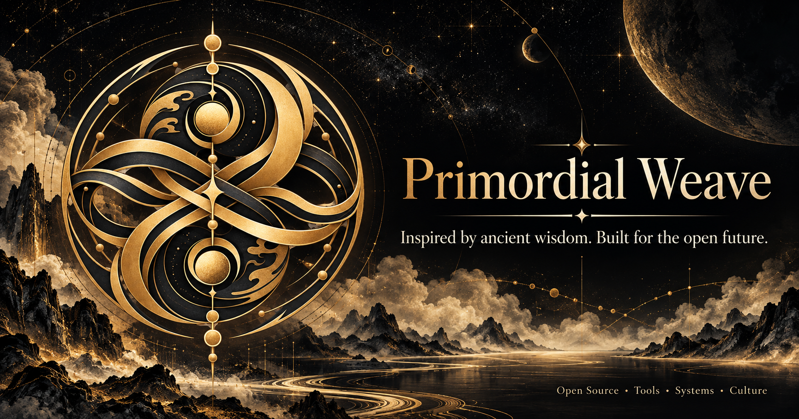

  

<h1 align="center">Primordial Weave</h1>

  <strong>Inspired by ancient wisdom. Built for the open future.</strong>

  An open-source collective exploring the intersection of Eastern philosophy, thoughtful design, and modern technology.

  Open Source · Tools · Systems · Culture

  
  

---

## Philosophy

Beneath the diversity of all things lies an underlying order.

Inspired by Chinese philosophy, Primordial Weave explores the relationships between the Dao, yin and yang, and the ever-changing patterns of the natural world.

We see a parallel in software.

Small ideas become useful tools. Independent components form coherent systems. Open collaboration creates things no individual could build alone.

We weave these ideas together, bringing the depth of ancient wisdom into conversation with the possibilities of modern technology.

## Our Work

### ◈ Tools

Thoughtfully crafted tools that make everyday work simpler, more intuitive, and more enjoyable.

### ◈ Systems

Reusable components, frameworks, and foundations designed for clarity, composability, and long-term maintainability.

### ◈ Culture

Digital experiences inspired by Eastern philosophy, traditional aesthetics, and the enduring ideas behind Chinese civilization.

Our projects may take different forms, but they share a common intention:

**To make useful things with clarity, care, and a sense of purpose.**

## Principles

**01 — Simplicity over excess**

Like a carefully composed ink painting, every element should have a reason to exist. We value clarity over unnecessary complexity.

**02 — Harmony through balance**

Inspired by yin and yang, we seek balance between power and simplicity, flexibility and consistency, tradition and innovation.

**03 — Craft over haste**

We care about thoughtful interfaces, sound architecture, meaningful details, and the experience of using what we build.

**04 — Open by nature**

Knowledge grows when it is shared. We believe in open collaboration, accessible documentation, and tools that empower people to create.

**05 — Build for the long term**

We prefer durable foundations over fleeting trends, creating work that remains useful, understandable, and adaptable over time.

## Our Approach

We do not treat tradition as something to preserve behind glass.

We treat it as a living source of ideas.

Ancient symbols can inspire new interfaces. Philosophical principles can inform software architecture. Traditional craftsmanship can teach us to pay attention to the smallest details.

The goal is not to imitate the past, but to discover what it can teach us about building the future.

## Join Us

Primordial Weave is an evolving open-source endeavor, and there is room for more people to contribute to its threads.

Whether you write code, design interfaces, improve documentation, explore cultural references, or simply enjoy building useful things, you are welcome to explore our work.

- Explore our repositories.
- Open an issue or suggest an improvement.
- Contribute code, documentation, ideas, or design.
- Help us make our tools more useful and our projects more thoughtful.

We value curiosity, constructive collaboration, and respect for different perspectives.

---

  <em>From the primordial, a thousand forms.</em>
   
  <em>From many threads, a greater whole.</em>

  <strong>Primordial Weave</strong>
   
  Inspired by ancient wisdom. Built for the open future.

